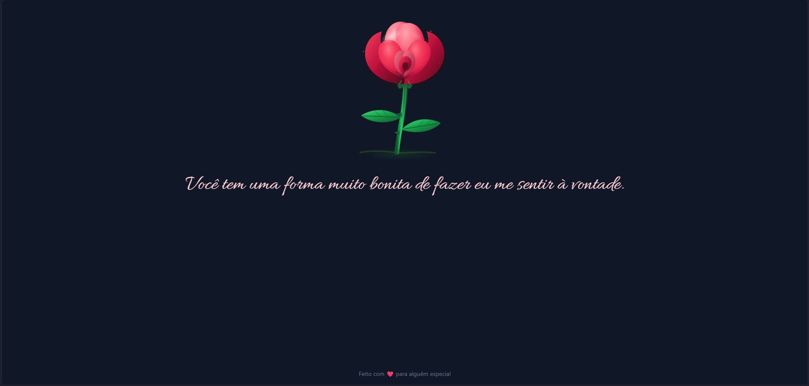

# 🌹 Bom Dia, Be

Uma aplicação web interativa e romântica que combina uma rosa animada com uma mensagem especial para cada dia do ano.
Um pequeno projeto feito para transformar um simples “bom dia” em algo especial.

🔗 Acesse o projeto online:
👉 https://bom-dia-be.vercel.app

<br />

## ✨ Funcionalidades

- 💌 Exibição de rosa animada e de mensagem romântica (diferente para cada dia do ano).

<br />

## 🛠️ Tecnologias Utilizadas

- ⚛️ React
- 🟦 TypeScript
- 🎨 Tailwind CSS
- ⚡ Vite

<br />

## 💻 Como Rodar o Projeto Localmente

Siga os passos abaixo para executar o projeto em sua máquina:

```bash
# Clone o repositório
git clone https://github.com/diegonatalo/rose.git

# Acesse a pasta do projeto
cd rose

# Instale as dependências
pnpm install

# Inicie o servidor de desenvolvimento
pnpm dev
```

📍 O projeto estará disponível em: http://localhost:5173

<br />

## 🛣️ Melhorias Futuras

- 💝 Criar mensagens especiais para datas comemorativas
- 🎂 Adicionar mensagens personalizadas para aniversários
- 💑 Criar uma área para datas importantes do casal
- 🌙 Alterar a mensagem de acordo com o período do dia
- 🌧️ Criar diferentes animações para diferentes momentos
- 🌸 Adicionar diferentes tipos de flores
- 🎨 Criar temas visuais alternativos
- 📱 Aprimorar a experiência em dispositivos móveis
- 🔊 Adicionar efeitos sonoros opcionais
- 💌 Permitir mensagens personalizadas
- 📆 Permitir visualizar mensagens de outros dias
- ✨ Criar efeitos especiais para datas importantes

<br />

## 🤝 Contribuição

Contribuições são sempre bem-vindas!

Para contribuir:

1. Faça um fork do projeto
2. Crie uma branch para sua feature (`git checkout -b feature/minha-feature`)
3. Commit suas alterações (`git commit -m 'feat: minha nova feature'`)
4. Faça push para a branch (`git push origin feature/minha-feature`)
5. Abra um Pull Request

<br />

## 📄 Licença

Este projeto está sob a licença MIT.
Sinta-se livre para usar, modificar e distribuir.

<br />
<p align="center">
  Desenvolvido com ❤️ por <a href="https://linkedin.com/in/diego-natalo"><b>Diego Natalo</b></a>
</p>
