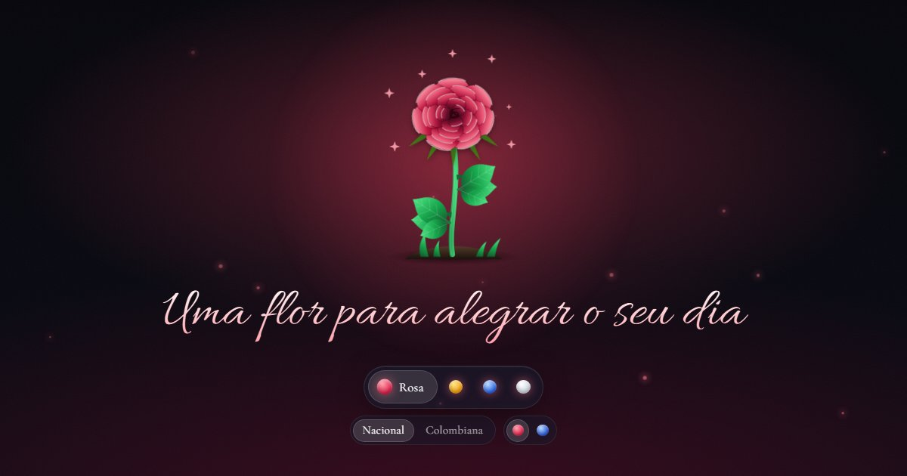

<div align="center">


# Mimoflor

**Uma flor para alegrar o dia de alguém.**<br />
Escolha uma flor, veja ela nascer em animação e compartilhe um link bonito, leve e sem cadastro.

<br />

[](https://mimoflor.vercel.app)


</div>

<br />

## ✨ O que dá para fazer

| Recurso | Descrição |
|---|---|
| **Escolher a flor** | Rosa, girassol, hortênsia ou lírio. A hortênsia abre por padrão. |
| **Personalizar a rosa** | Escolha o tipo (nacional, vista de cima, ou colombiana, de taça alta) e a cor (vermelha ou azul). |
| **Ver a flor nascer** | O caule brota, as folhas se desenrolam e as pétalas se abrem uma a uma. Depois ela balança e brilha. |
| **Clima que acompanha a flor** | O fundo, o brilho e a poeira de luz mudam de cor com a flor escolhida. |
| **Compartilhar por link** | A flor fica no endereço (`?flor=rosa&tipo=colombiana&cor=azul`). Quem abre o link vê a mesma flor. |
| **Usar no celular** | A flor se ajusta à largura e à altura da tela, e a animação é leve em aparelhos simples. |
| **Navegar pelo teclado** | O seletor funciona com teclado e a animação é encurtada para quem prefere menos movimento. |
| **Página 404 própria** | Endereços e flores que não existem levam a um broto que ainda não floresceu. |

## 🖼️ Telas

Imagens de prévia geradas a partir do próprio site, com a animação no estado final.

<table>
  <tr>
    <td width="50%"><br /><sub><b>Rosa nacional</b>: pétalas em espiral, vista de cima.</sub></td>
    <td width="50%"><br /><sub><b>Rosa colombiana azul</b>: taça alta, na cor azul.</sub></td>
  </tr>
  <tr>
    <td width="50%"><br /><sub><b>Girassol</b>: miolo escuro e pétalas amarelas.</sub></td>
    <td width="50%"><br /><sub><b>Lírio</b>: pétalas brancas e alongadas.</sub></td>
  </tr>
</table>

## 🧠 Como funciona

| Conceito | Regra |
|---|---|
| **Flor padrão** | Sem `flor` na URL, abre a hortênsia. |
| **Parâmetros** | `flor` (`rosa`, `girassol`, `hortensia`, `lirio`), e só para a rosa: `tipo` (`nacional`, `colombiana`) e `cor` (`vermelha`, `azul`). |
| **Valor inválido** | Um valor que não existe em `flor`, `tipo` ou `cor` leva à página 404. |
| **Parâmetros de fora** | `utm_source`, `fbclid` e similares são ignorados. `tipo` e `cor` em flor que não os tem também. |
| **Opções da rosa** | Na abertura da página, entram só depois do seletor de flores. Em trocas seguintes, aparecem na hora. |
| **Animação** | Só CSS, sem biblioteca. As flores são SVG desenhado em código. |

A lógica da URL fica em `src/lib/flower-url.ts`, e cada flor declara o próprio texto de URL (`slug`) no registro.

## 🚀 Rodando localmente

Requer [Node.js](https://nodejs.org) e [pnpm](https://pnpm.io).

```bash
git clone https://github.com/diegonatalo/rose.git
cd rose
pnpm install
pnpm dev        # http://localhost:5173
```

| Comando | O que faz |
|---|---|
| `pnpm dev` | Servidor de desenvolvimento com HMR |
| `pnpm build` | Checa os tipos e gera o build de produção |
| `pnpm preview` | Serve o build de produção |
| `pnpm lint` | Roda o ESLint |

## 🗂️ Estrutura

```text
src/
├── App.tsx                  "/" abre a home, qualquer outro caminho abre a 404
├── index.css                temas por flor, fundo, tipografia e seletor
├── lib/
│   └── flower-url.ts        lê e escreve a flor escolhida na URL
├── pages/
│   ├── home.tsx             flor, frase e seletor
│   └── not-found.tsx        página 404
└── components/
    ├── flower.tsx           monta o SVG da flor escolhida
    ├── flower.css           linha do tempo e keyframes da animação
    ├── flower-picker.tsx    seletor de flores
    ├── flower-options.tsx   opções da flor escolhida (tipo, cor)
    ├── message.tsx          frase abaixo da flor
    ├── stage.tsx            fundo com halo e poeira de luz
    └── flowers/
        ├── registry.tsx     flores disponíveis, slugs e opções
        ├── shared.tsx       caule, folhas, chão, brilhos e pétala genérica
        ├── palettes.ts      cores (vermelha e azul) das rosas
        ├── utils.ts         aleatório determinístico e helper de variáveis CSS
        └── rose, colombian-rose, sunflower, hydrangea, lily
```

<details>
<summary><b>Como adicionar uma nova flor</b></summary>

<br />

1. Crie `src/components/flowers/minha-flor.tsx` exportando um componente de gradientes (`MinhaFlorDefs`) e um da planta (`MinhaFlorPlant`). Use `Stem`, `Leaf` e `Petal` de `shared.tsx`.
2. Registre a flor em `flowers/registry.tsx`: nome, `slug` da URL, cor da bolinha no seletor e uma função `view` que devolve o desenho, o tema, a cor dos brilhos, a posição da cabeça e o segundo em que ela começa a abrir.
3. Crie o tema de cores em `index.css`, no bloco `.stage[data-flower="..."]`.
4. Para dar variações (como tipo e cor da rosa), declare `options` no registro. O seletor desenha a fileira de opções sozinho, e `view` recebe a escolha feita.

</details>

## 🌐 Deploy

Publicado na [Vercel](https://vercel.com). O `vercel.json` manda todos os caminhos para o `index.html` (SPA fallback), e assim a 404 do site aparece no lugar da padrão da Vercel.

> [!NOTE]
> As URLs das meta tags Open Graph, em `index.html`, são absolutas. Se o domínio mudar, atualize-as.

Ícones e imagens ficam em `public/`:

| Arquivo | Para que serve |
|---|---|
| `favicon.svg`, `favicon-32.png`, `apple-touch-icon.png` | Ícone do site |
| `og-image.jpg` | Prévia do link compartilhado (1200×630), hoje a da hortênsia |
| `og/*.jpg` | Uma prévia pronta para cada flor, ainda sem uso nas meta tags |

## 🧭 Próximos passos

- [ ] Prévia de link diferente por flor (hoje as meta tags são fixas, então o link mostra sempre a hortênsia)
- [ ] Mensagens personalizadas
- [ ] Mais flores (tulipa, margarida, orquídea)
- [ ] Mensagens para datas especiais, como aniversários
- [ ] Testes automatizados e CI (hoje só há `tsc` e ESLint)

## Licença

[MIT](LICENSE), © 2026 Diego Natalo.

<br />

<div align="center">
  <sub>Feito com 💗 para quem quer alegrar o dia de alguém.</sub>
</div>
